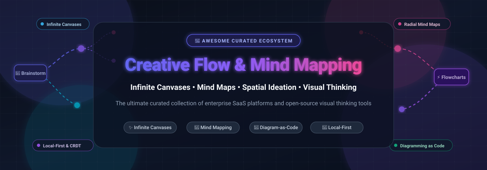

  

# 🎨 Awesome Creative Flow & Mind-Mapping Tools

  
  
  
  
  
  

> 🌟 **A carefully curated index of industry-leading SaaS platforms and top open-source repositories** designed for **infinite visual canvases**, **radial mind mapping**, **spatial brainstorming**, **flowcharting**, **concept graphs**, and **diagramming-as-code**. Perfect for software engineers, product designers, visual thinkers, system architects, and researchers.

---

## 📑 Table of Contents

- [🌐 Sector Overview & Market Dynamics](#-sector-overview--market-dynamics)
- [💼 SaaS & Hosted Platforms](#-saas--hosted-platforms)
- [💻 Open-Source GitHub Projects](#-open-source-github-projects)
- [📈 Star History](#-star-history)
- [🤝 How to Contribute](#-how-to-contribute)
- [💖 Support & Sponsor](#-support--sponsor)
- [⚖️ Disclaimer](#️-disclaimer)

---

## 🌐 Sector Overview & Market Dynamics

The global visual collaboration and digital whiteboard software market is valued at approximately **$8.5B–$11.2B in 2024–2025** (scaling toward **$19B–$21B+ by 2026** at an estimated CAGR of ~15–20%), complemented by a specialized **$2.0B–$5.5B** dedicated mind-mapping and cognitive outliner sector. Structurally, the overall market exhibits **moderate-to-high platform concentration** among visual whiteboard ecosystems (dominated by enterprise suites like Miro, Lucid Software, Mural, and bundled giants like Microsoft Whiteboard), while the specialized radial mind-mapping and diagramming sub-segment remains **healthy and fragmented** with robust competition across focused SaaS innovators, privacy-first desktop engines, and local-first open-source frameworks.

---

## 💼 SaaS & Hosted Platforms

| Product | Company Valuation / Revenue Size | Starting Price (Paid Tiers) | Free Tier Limits / Evaluation Policy | Core Capabilities & Highlights |
| :--- | :--- | :--- | :--- | :--- |
| **[Miro](https://miro.com)** | **$1.79B** valuation (acquired by Bending Spoons; ~$600M+ ARR; formerly $17.5B peak) | **$8.00 / member / month** (Starter, billed annually) or $10.00/mo monthly | **3 editable boards**, unlimited team members, premade template library, basic integrations, 2,500 core Miro AI tokens | Enterprise-grade infinite whiteboard, real-time workshops, sticky notes, visual wireframing, and multi-app integrations. |
| **[Lucidspark (Lucid Software)](https://lucid.co)** | **$3.00B** valuation (~$150M+ ARR) | **$7.95 / user / month** (Individual, billed annually) or $9.95/mo monthly | **3 editable boards**, 300 objects per board, voting/breakout room limits, basic integrations | Virtual whiteboard and ideation canvas with sticky grouping, voting, timers, and 1-click sync into Lucidchart architecture diagrams. |
| **[Mural](https://mural.co)** | **$2.00B** valuation (~$125M–$189M ARR) | **$9.99 / member / month** (Team+, billed annually) or $12.00/mo monthly | **3 active murals**, unlimited members, infinite canvas, full template library, 14-day free trial on Team+ features | Enterprise visual collaboration canvas engineered for guided brainstorming, design sprints, affinity mapping, and agile ceremonies. |
| **[MeisterLabs / MindMeister](https://mindmeister.com)** | **$21M–$23M ARR** ($52M growth funding) | **$6.00 / month** (Personal, billed annually) or $7.00/mo monthly | **3 mind maps**, unlimited collaborators, Meister AI trial credits; no image/file attachments or PDF/Word exports | Intuitive web-based collaborative mind-mapping tool with slide deck presentations and direct 1-click export to MeisterTask. |
| **[Whimsical](https://whimsical.com)** | **$7M–$10M ARR** ($30M Series A funding) | **$10.00 / editor / month** (Pro, billed annually) or $12.00/mo monthly | **50 new board objects / month**, 50 doc blocks / month, 1 GB storage, 7-day version history, watermarked exports | Lightning-fast unified workspace combining sticky notes, mind maps, flowcharts, wireframes, and collaborative docs in one canvas. |
| **[OpenGenius / Ayoa](https://ayoa.com)** | **~$5M–$10M ARR** (Privately held UK software house) | **$10.00 / user / month** (Ultimate, billed annually) or $17.00/mo monthly | **10 mind maps** on free tier; whiteboards and visual task boards lock to view-only; AI features locked behind Ultimate | Neurodiversity-focused workspace blending organic hand-drawn branches, radial speed maps, task boards, and dyslexia-friendly views. |
| **[XMind & XMind AI Cloud](https://xmind.com)** | **~$5M–$8M ARR** (Over 100M+ global installations) | **$4.92 / month** ($59.00/year billed annually) or $10.00/mo monthly for Pro | **10 cloud mind maps**, limited sheets/nodes; exports carry an XMind watermark; AI trial capped at 50 credits | Veteran cross-platform mind-mapping suite offering radial trees, fishbone diagrams, timeline logic charts, and pitch presentation mode. |
| **[GitMind](https://gitmind.com)** | **~$2M–$5M ARR** (Part of Wowed/Apowersoft network) | **$4.08 / month** ($49.00/year billed annually) or $9.00/mo monthly | **10 active mind maps/files**, 30 AI prompt credits, 1 collaborative Planet workspace; image exports restricted to SD | Modern cloud-based AI mind-mapping, flowchart, and concept organizer with prompt-to-map generation and cross-device sync. |
| **[Coggle](https://coggle.it)** | **~$1M–$3M ARR** (Bootstrapped / Lean team) | **$5.00 / month** (Awesome plan, flat monthly fee) or $8.00/member/mo for Org | **3 private diagrams**, unlimited public diagrams, real-time collaboration, 3.7MB image uploads, full export options | Color-coded organic branch mind-mapping web application featuring Markdown formatting, loop connections, and image uploads. |
| **[MindNode (IdeasOnCanvas)](https://mindnode.com)** | **~$1M–$3M ARR** (Bootstrapped Apple ecosystem developer) | **$2.49 / month** ($24.99/year billed annually) or $2.99/mo monthly for Plus | **Free Viewer/Basic Editor** (basic node creation & format import/export); 14-day free trial for MindNode Plus | Refined Apple-native mind-mapping application for Mac, iPad, and Vision Pro featuring visual tags, focus mode, and outline sync. |

---

## 💻 Open-Source GitHub Projects

Curated open-source projects, infinite canvas engines, and mind-mapping suites, ordered by GitHub star count:

- **[Excalidraw](https://github.com/excalidraw/excalidraw)**   
  🎨 *Flagship open-source virtual whiteboard with a natural hand-drawn aesthetic, end-to-end encrypted real-time multiplayer collaboration, custom component libraries, and local-first storage.*

- **[Mermaid.js](https://github.com/mermaid-js/mermaid)**   
  📊 *Industry-standard JavaScript diagramming and mind-mapping engine that renders interactive flowcharts, mind maps, sequence diagrams, and class charts directly from markdown-like text.*

- **[AppFlowy](https://github.com/AppFlowy-IO/AppFlowy)**   
  📝 *Leading open-source Notion and Miro alternative with full data privacy, modular canvas boards, nested document trees, and flexible brainstorming views.*

- **[AFFiNE](https://github.com/toeverything/AFFiNE)**   
  🚀 *All-in-one open-source knowledge base and hyper-fused whiteboard/document canvas supporting local-first CRDT synchronization, shape grouping, and edgeless mind mapping.*

- **[Draw.io Desktop](https://github.com/jgraph/drawio-desktop)**   
  📐 *Feature-packed, offline-capable desktop diagramming and flowchart suite completely free of third-party trackers, featuring deep mind mapping and architecture palettes.*

- **[Penpot](https://github.com/penpot/penpot)**   
  🖌️ *Open-source web-based design and prototyping workspace for cross-functional teams, featuring infinite creative vector boards, flex layouts, and design-to-code flows.*

- **[tldraw](https://github.com/tldraw/tldraw)**   
  ✨ *Modern, high-performance open-source infinite canvas engine and React SDK designed for building collaborative whiteboards, spatial ideation tools, and AI canvases.*

- **[Logseq](https://github.com/logseq/logseq)**   
  🔗 *Privacy-first, open-source outliner and graph-based personal knowledge management base featuring a built-in infinite visual whiteboard canvas for connected note-taking.*

- **[xyflow (React Flow & Svelte Flow)](https://github.com/xyflow/xyflow)**   
  ⚡ *Powerful open-source library for building node-based user interfaces, interactive mind-map canvases, dynamic flowchart builders, and complex visual workflow graphs.*

- **[D2](https://github.com/terrastruct/d2)**   
  💡 *Modern, declarative diagramming language and CLI compiler designed for turning text into clear software architecture maps, network graphs, and hierarchy charts.*

- **[Drawnix](https://github.com/plait-board/drawnix)**   
  ✏️ *All-in-one open-source web whiteboard uniting mind mapping, freehand sketching, and structural flowcharts in a unified, modern interface.*

- **[PlantUML](https://github.com/plantuml/plantuml)**   
  📜 *Classic open-source diagramming engine generating mind maps, work breakdown structures (WBS), sequence diagrams, and architecture maps from human-readable plain text.*

- **[Markmap](https://github.com/markmap/markmap)**   
  📄 *Fast open-source visualization tool that compiles standard Markdown headings and lists directly into interactive, zoomable SVG radial mind maps.*

- **[Simple-Mind-Map](https://github.com/wanglin2/mind-map)**   
  🌈 *Comprehensive open-source web mind-mapping engine and web application supporting fishbone structures, timeline layouts, rich formatting, and XMind import/export.*

- **[diagrams.net (Web Core)](https://github.com/jgraph/drawio)**   
  🌐 *The web client source behind diagrams.net, delivering self-hostable collaborative whiteboards and extensive diagramming libraries.*

- **[Lorien](https://github.com/mbrlabs/Lorien)**   
  🖌️ *Ultra-fast, infinite-canvas vector sketching and brainstorming notebook built with the Godot Engine for frictionless ideation.*

- **[Freeplane](https://github.com/freeplane/freeplane)**   
  🌲 *Battle-tested open-source desktop mind-mapping application with hierarchical node folding, LaTeX math formulas, metadata tagging, and Groovy scripting.*

- **[My-Mind](https://github.com/ondras/my-mind)**   
  🧠 *Lightweight, zero-dependency browser-based mind-mapping tool supporting keyboard-first navigation and seamless cloud storage integrations.*

- **[Mind-Elixir](https://github.com/SSShooter/mind-elixir-core)**   
  🧩 *Framework-agnostic JavaScript mind-map core library featuring node drag-and-drop reparenting, multi-node summaries, keyboard shortcuts, and PNG/JSON exports.*

- **[zachlatta/freeflow](https://github.com/zachlatta/freeflow)**   
  🌊 *Frictionless spatial brainstorming canvas designed for fluid thinking, rapid thought capture, and dynamic relational connections.*

- **[Minder](https://github.com/phase1geo/Minder)**   
  🐧 *Sleek native GTK desktop mind-mapping application for Linux featuring animated layouts, contextual task checkboxes, custom themes, and FreeMind/XMind compatibility.*

- **[Heimer](https://github.com/juzzlin/Heimer)**   
  💡 *Clean, open-source Qt mind-mapping and concept-modeling tool for quick ideation and clean XML-based file storage.*

---

## 📈 Star History

---

## 🤝 How to Contribute

Contributions make the open-source community an inspiring place to learn, create, and build!

1. 🍴 **Fork the Project**
2. 🌿 **Create your Feature Branch** (`git checkout -b feature/NewAwesomeTool`)
3. 💾 **Commit your Changes** (`git commit -m 'Add NewAwesomeTool'`)
4. 🚀 **Push to the Branch** (`git push origin feature/NewAwesomeTool`)
5. 📬 **Open a Pull Request**

*Please ensure added SaaS entries include specific pricing tiers, free limits, and revenue scale, and open-source entries include valid GitHub repository URLs with star badges.*

---

## 💖 Support & Sponsor

Thank you for exploring and sharing this collection! If you find this curated list valuable for your workflow, research, or creative projects, please consider supporting the project:

- ⭐ **Star this repository** to help others discover these tools.
- 🍴 **Fork & Share** with your teammates, friends, or community on X/Twitter, LinkedIn, and Reddit.
- ☕ **Buy me a coffee & support my ongoing open-source curation on the [GitHub Sponsors Dashboard](https://github.com/sponsors/ishandutta2007)**.

  

---

## ⚖️ Disclaimer

- This is a **community-curated** list for informational and comparative purposes only, not an official endorsement.
- All product names, logos, and brands are property of their respective owners.
- Open-source licenses vary across entries (`MIT`, `Apache-2.0`, `GPL-3.0`, and commercial/source-available models like `tldraw`). Please verify specific licensing before embedding engines in proprietary or commercial systems.

---

  <b>Built with ❤️ for visual thinkers, product designers, software architects, and the open-source community.</b>

